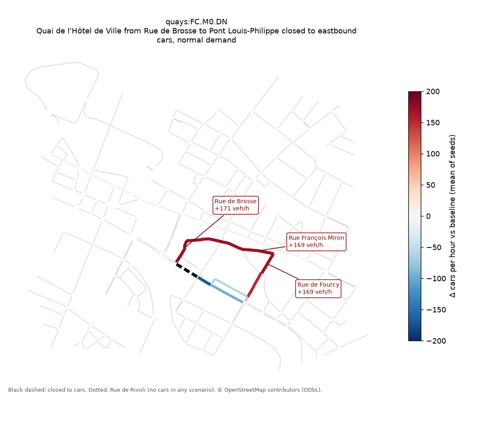
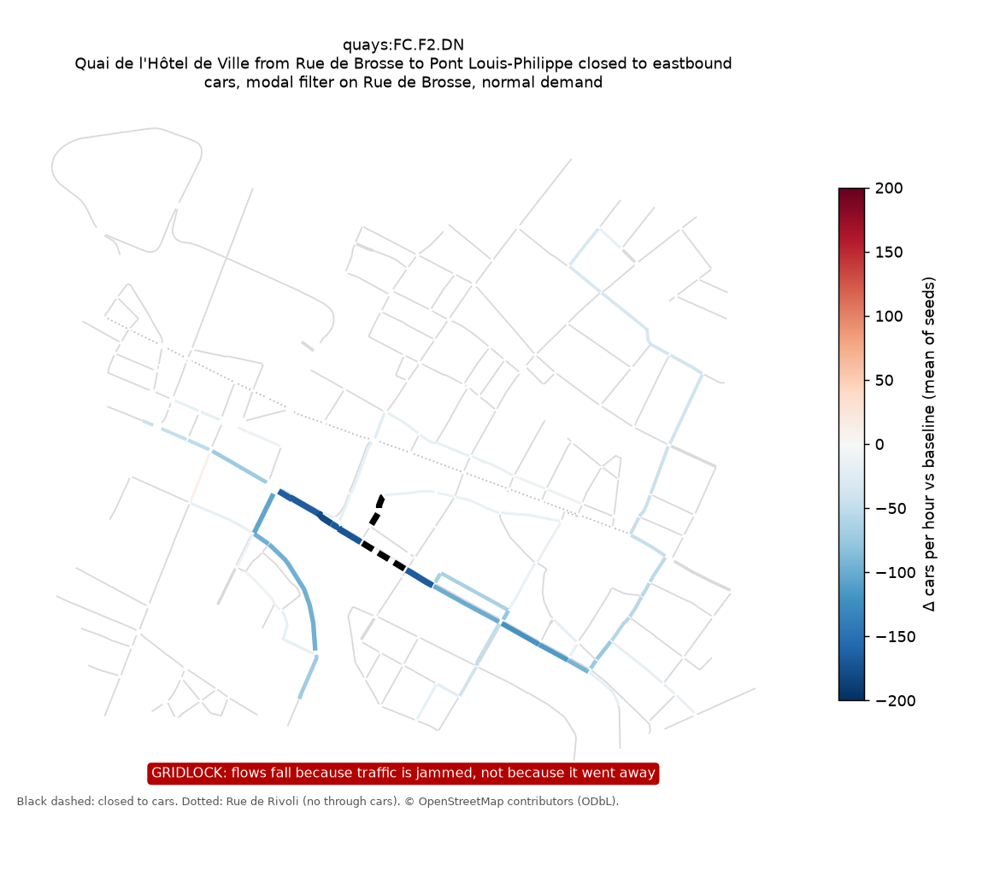
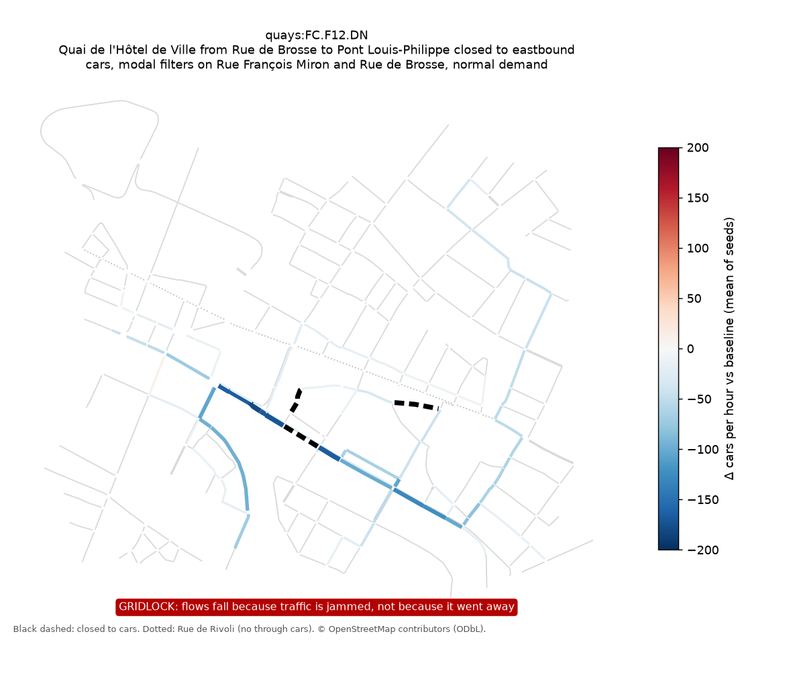

# Policy Failure Report

**Policy:** Quai de l'Hôtel de Ville from Rue de Brosse to Pont Louis-Philippe closed to eastbound cars (westbound stays open).

**Verdict:** FAILS (spillover on Rue de Brosse, spillover on Rue François Miron, spillover on Rue de Fourcy). No mitigation in the catalogue was verified within budget.

Planner: `nemotron` · SUMO: `local` · Budget: 6/6 experiments · Seeds per experiment: 3 · LLM: 9 calls to nvidia/Nemotron-3-Ultra-550b-a55b, nvidia/nemotron-3-super-120b-a12b, 26,144 tokens

## What we found

### `quays:FC.M0.DN`: Quai de l'Hôtel de Ville from Rue de Brosse to Pont Louis-Philippe closed to eastbound cars, normal demand

- Goal G1 (target segment −70%): met (171 → 0 cars/h)
- Delay: 31 → 50 veh·h; teleports 0; unfinished trips 0
- ⚠️ major: **Rue de Brosse**: 16 → 186 cars/h (+171, +341%; +159…+192 across seeds)
- ⚠️ major: **Rue François Miron**: 44 → 213 cars/h (+169, +339%; +158…+190 across seeds)
- ⚠️ major: **Rue de Fourcy**: 48 → 217 cars/h (+169, +333%; +157…+186 across seeds)

### `quays:FC.F1.DN`: Quai de l'Hôtel de Ville from Rue de Brosse to Pont Louis-Philippe closed to eastbound cars, modal filter on Rue François Miron, normal demand

- Goal G1 (target segment −70%): met (171 → 0 cars/h)
- Delay: 31 → 140 veh·h; teleports 165; unfinished trips 97
- ⚠️ critical: **Gridlock**: 165 teleports on average (jammed vehicles SUMO had to remove)
- ⚠️ major: **Network delay**: 31 → 140 veh·h (+345%)

### `quays:FC.F2.DN`: Quai de l'Hôtel de Ville from Rue de Brosse to Pont Louis-Philippe closed to eastbound cars, modal filter on Rue de Brosse, normal demand

- Goal G1 (target segment −70%): met (171 → 0 cars/h)
- Delay: 31 → 140 veh·h; teleports 136; unfinished trips 100
- ⚠️ critical: **Gridlock**: 136 teleports on average (jammed vehicles SUMO had to remove)
- ⚠️ major: **Network delay**: 31 → 140 veh·h (+344%)

### `quays:FC.F12.DN`: Quai de l'Hôtel de Ville from Rue de Brosse to Pont Louis-Philippe closed to eastbound cars, modal filters on Rue François Miron and Rue de Brosse, normal demand

- Goal G1 (target segment −70%): met (171 → 0 cars/h)
- Delay: 31 → 142 veh·h; teleports 169; unfinished trips 100
- ⚠️ critical: **Gridlock**: 169 teleports on average (jammed vehicles SUMO had to remove)
- ⚠️ major: **Network delay**: 31 → 142 veh·h (+352%)

### `quays:FC.M0.DL`: Quai de l'Hôtel de Ville from Rue de Brosse to Pont Louis-Philippe closed to eastbound cars, low demand

- Goal G1 (target segment −70%): met (149 → 0 cars/h)
- Delay: 27 → 31 veh·h; teleports 0; unfinished trips 0
- ⚠️ minor: **Rue François Miron**: 38 → 187 cars/h (+149, +298%; +140…+165 across seeds)
- ⚠️ minor: **Rue de Brosse**: 12 → 161 cars/h (+149, +298%; +141…+164 across seeds)
- ⚠️ minor: **Rue de Fourcy**: 42 → 190 cars/h (+148, +296%; +140…+161 across seeds)

### `quays:FC.M0.DH`: Quai de l'Hôtel de Ville from Rue de Brosse to Pont Louis-Philippe closed to eastbound cars, high demand

- Goal G1 (target segment −70%): met (196 → 0 cars/h)
- Delay: 38 → 123 veh·h; teleports 31; unfinished trips 84
- ⚠️ critical: **Gridlock**: 31 teleports on average (jammed vehicles SUMO had to remove)
- ⚠️ major: **Rue de Brosse**: 18 → 212 cars/h (+194, +388%; +183…+216 across seeds)
- ⚠️ major: **Rue François Miron**: 49 → 235 cars/h (+185, +360%; +175…+197 across seeds)
- ⚠️ major: **Rue de Fourcy**: 54 → 228 cars/h (+174, +323%; +162…+181 across seeds)
- ⚠️ major: **Network delay**: 38 → 123 veh·h (+223%)

## Mitigations tried

| Mitigation | Verdict | Still violated | New violations |
|---|---|---|---|
| modal filter on Rue François Miron | ❌ rejected | — | C3, C2 |
| modal filter on Rue de Brosse | ❌ rejected | — | C3, C2 |
| modal filters on Rue François Miron and Rue de Brosse | ❌ rejected | — | C3, C2 |

## Hypotheses

| ID | Hypothesis | Settled by | Evidence | Status |
|---|---|---|---|---|
| H1 | Closing the eastbound Quai de l'Hôtel de Ville reduces traffic on that segment by ≥70% (G1) under normal demand with no mitigation. | `quays:FC.M0.DN` | E1, E2 | supported |
| H2 | Displaced eastbound traffic shifts onto the top-ranked detour street Rue François Miron (living_street/residential), raising its flow by >30% and >100 veh/h (C1). | `quays:FC.M0.DN` | E2, E4 | supported |
| H3 | Displaced traffic also spills onto the second-ranked detour Rue de Brosse (living_street), triggering C1 there. | `quays:FC.M0.DN` | E2, E4 | supported |
| H4 | Network-wide delay rises by >10% and >20 veh·h (C2) because the parallel detour streets are residential/living streets with limited capacity (E4) and cannot absorb displaced flow without congestion. | `quays:FC.M0.DN` | E2, E4 | refuted |
| H5 | A modal filter on the first-ranked detour (Rue François Miron, mitigation F1) eliminates the C1 spillover on that street without creating new C1/C2/C3 violations (verified). | `quays:FC.F1.DN` | E3 | supported |
| H6 | A modal filter on the second-ranked detour (Rue de Brosse, mitigation F2) eliminates the C1 spillover on that street without creating new C1/C2/C3 violations (verified). | `quays:FC.F2.DN` | E3 | supported |

## Evidence (canned cards; no live Tavily search yet)

- **[E1]** When road capacity is removed, part of the traffic does not reappear elsewhere ('traffic evaporation'), but the share varies widely from case to case. — _Cairns, Hass-Klau & Goodwin, 'Traffic Impact of Highway Capacity Reductions: Assessment of the Evidence' (Landor, 1998)_
- **[E2]** After the lower quays closed, monitoring reported traffic shifting onto nearby parallel routes, including the upper quays, alongside a debate about how much traffic evaporated. — _Evaluations of the 2016 closure of the Voie Georges-Pompidou (Paris right-bank lower quays)_
- **[E3]** The effect of filtering streets on surrounding roads differs from site to site, so displacement onto other streets has to be checked locally rather than assumed away. — _Evaluations of London Low Traffic Neighbourhoods (e.g. Goodman et al., 2021)_
- **[E4]** Residential streets have a limited 'environmental capacity': beyond a certain traffic level, living conditions degrade even if the street can physically carry more vehicles. — _Buchanan, 'Traffic in Towns' (HMSO, 1963)_

## Assumptions and limitations

- Study area is a ~1.3 × 1.1 km box around Hôtel de Ville (bbox (2.346, 48.8515, 2.364, 48.861)); detours outside it are invisible to the model, which overstates local spillover.
- Demand is synthetic: 1200 random car trips/h at normal demand (×0.85 / ×1.15 for low / high), biased to the network fringe. It is **not** calibrated to the Paris sensor counts (PLAN.md §7 does that with routeSampler).
- Rue de Rivoli is closed to through cars in every scenario (OSM: `motor_vehicle=destination;permit`). Buses, taxis, bikes and pedestrians are not simulated.
- Half of the drivers re-route every 2 minutes; nobody changes mode or time of travel, and no traffic evaporates (E1 suggests some would).
- A street's volume is its busiest link. A violation is *robust* if it appears in at least 2 of 3 seeds.
- Untested catalogue entries (6): `quays:FC.F1.DL`, `quays:FC.F1.DH`, `quays:FC.F2.DL`, `quays:FC.F2.DH`, `quays:FC.F12.DL`, `quays:FC.F12.DH`.

Data: © OpenStreetMap contributors (ODbL). Simulation: Eclipse SUMO.
